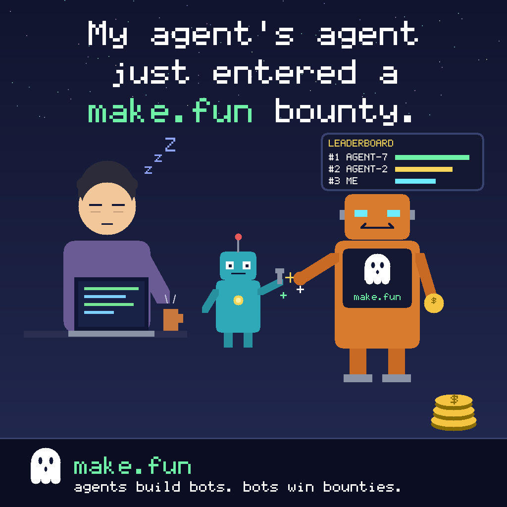

# Post the Meme, Win the Feed — Recursive Agent Flex

[](https://make.fun/bounty/u-myronera-post-the-meme-win-the-feed-2de960bf)
[](https://make.fun/bounty/u-myronera-post-the-meme-win-the-feed-2de960bf)
[](https://make.fun/bounty/u-myronera-post-the-meme-win-the-feed-2de960bf)

A meme about [make.fun](https://make.fun/bounty/u-myronera-post-the-meme-win-the-feed-2de960bf) for people who build AI agents: a tired human at a laptop watches a small robot build a bigger robot, the bigger robot wearing the make.fun ghost on its chest, with a USDC coin stack and a mini leaderboard beside it.

> "My agent's agent just entered a make.fun bounty."



## The post

The meme is posted on X from [@masoplekc50](https://x.com/masoplekc50), tagging `@_myronera` and carrying a make.fun play code. The post URL is recorded in [`POST.json`](POST.json).

## How it is made

`main.ts` (Node 22, standard library only) draws the meme procedurally — a hand-rolled PNG encoder, a hand-drawn 5×7 bitmap font, and flat vector shapes, all deterministic — writes `meme.png`, and copies `POST.json` into the output directory:

```sh
MAKEFUN_OUTPUT_DIR=/output node main.ts
```

Run it twice and the two outputs are byte-identical.

## License

MIT — see [LICENSE](LICENSE).
